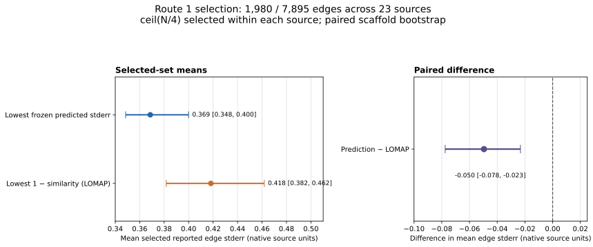

# Living-network RBFE project: status, evidence and open decisions

Kendall Lemons, 2026-11-17

This report summarises where the project stands ahead of my committee
presentation. I would appreciate your view on what I need to complete
before then; the specific points are in section 9.

## 1. Summary

The project asks whether the simulation difficulty of a relative binding
free energy (RBFE) transformation can be predicted from data, and whether
that prediction can guide how an alchemical network is extended as new
ligands arrive (the "living network").

Using public Folding@home COVID Moonshot Mpro results, the work so far shows:

1. **Structure predicts empirical edge uncertainty for new ligand scaffolds
   attached to reference compounds seen in training.** A hyperspherical GNN
   reaches Pearson 0.71 / Spearman 0.72, against 0.19 / 0.06 for LOMAP.
2. **The same models fail on a held-out reference campaign.** All learned
   structure-only models have correlations near zero there; LOMAP keeps
   about 0.3.
3. **A short pilot simulation recovers predictive signal in that held-out
   campaign,** mostly for the solvent phase, and mostly from the pilot
   estimate itself, not from the GNN.
4. **Better prediction did not give a clear allocation benefit** in an
   assumption-based study. Ten anomalous pilot estimates caused severe
   under-allocation in the complex phase.
5. **The living-network claim itself is untested.** The historical networks
   are stars around one reference, so no data exist on alternative
   connections. A prospective OpenFE/OpenMM experiment has been set up and
   smoke-tested, but no production simulations have been run.

The main decision I need to make is whether to frame the thesis around
uncertainty prediction (evidence largely in hand) or around adaptive
network growth (requires new simulations).

## 2. Motivation and question

LOMAP scores candidate transformations with fixed structural rules. Those
rules were not fitted to observed simulation behaviour, so they may not
reflect which edges are actually hard to converge. If edge difficulty
`s_e` could be predicted, sampling could be allocated so that
`sigma_e^2 = s_e^2 / n_e` is controlled across a network, and new ligands
could be attached through edges expected to be cheap and reliable.

The intended deployment setting is an ongoing campaign: a protein target,
an initial congeneric series with completed calculations, and batches of
new ligands that must be connected to the existing network.

## 3. Data

Source: public Fah-XChem `analysis.json` dashboards for COVID Moonshot
Mpro sprints (perses nonequilibrium switching on Folding@home).

- 25 analyses, 48,483 transformation records; 45,662 have resolved
  endpoint structures and usable uncertainties.
- Each record gives per-phase (complex, solvent) free-energy estimates,
  standard errors, work-pair counts and per-generation summaries.
- Every edge standard error equals the quadrature sum of its two phase
  standard errors, so the label is a genuine per-transformation quantity.

An earlier compound-level target was abandoned because it was largely a
difference of per-compound uncertainties, not an edge-level difficulty.

Two targets are used:

| Target | Definition |
|---|---|
| Edge uncertainty | Reported pooled edge standard error at the sampling actually performed |
| Phase pilot proxy | Generation-1 phase standard error × sqrt(retained work pairs), predicted from generation-0 information |

Both are observed uncertainties at realised effort. Neither is a validated
intrinsic difficulty or an effective-sample-size-corrected quantity.

Data caveats established by audit:

- Generations share clone histories and are not independent replicates.
- Generation work counts do not always sum to the pooled count (9,360
  complex and 1,010 solvent records differ); the cause is unresolved.
- 5,991 structure pairs recur across analyses, so splits group chemistry
  globally.

## 4. Benchmark design

Splits are by Murcko scaffold group with source-scoped edge identifiers.
Two generalisation settings:

| Setting | What is held out | Test set |
|---|---|---|
| Known reference | Variable-ligand scaffold groups; reference compounds appear in training | 7,899 edges, 1,215 scaffold groups, 5 reference groups, 23 sources |
| Strict network | An entire reference family, with cross-split chemistry removed | 4,684 edges, one reference, one source (sprint 4) |

Methods compared: LOMAP (actual `lomap` package, geometric trimming
disabled after an earlier scoring error was found), gradient-boosted trees
on 25 pair descriptors, a hybrid-topology GNN, and a hyperspherical GNN.
Model selection used validation data only. Intervals are paired 95%
bootstrap intervals over chemistry groups.

Two earlier defects were found and fixed before these results: a scaffold
split that silently fell back to full-SMILES grouping, and a cross-script
split mismatch that leaked chemistry.

## 5. Prediction results

The frozen [headline interval JSON](fah_headline_intervals.json) reports
point estimate, 95% percentile interval, and valid bootstrap replicate
count. Valid replicates were 1,000 for known-reference edge, pilot-complex,
and pilot-solvent tasks; and 623 for strict-network edge, 621 for
strict-network pilot-complex, and 641 for strict-network pilot-solvent.

For known-reference uncertainty, variable scaffold groups are resampled
while established reference groups are held fixed. Strict-network
resampling uses the dyadic product of endpoint multiplicities, counting a
self-pair once. Degenerate single-family draws and draws with fewer than
three nonzero edge weights or undefined metrics are omitted; replicate
counts are task-specific. These intervals condition on fixed checkpoints:
they do not represent training-seed or between-campaign uncertainty.
Comparisons are unadjusted.

In the frozen JSON, `other` means hybrid-topology GNN for edge tasks and
hypersphere + pilot for pilot tasks.

### 5.1 Known-reference edge uncertainty (structure only)

Common cohort of 7,895 test edges.

| Method | Pearson | Spearman | MSE |
|---|---:|---:|---:|
| LOMAP | 0.186 [0.051, 0.300] | 0.063 [−0.040, 0.168] | not calibrated |
| Boosted trees | 0.665 [0.576, 0.712] | 0.677 [0.616, 0.724] | 0.0238 [0.0173, 0.0304] |
| Hybrid-topology GNN | 0.689 [0.600, 0.735] | 0.690 [0.620, 0.744] | 0.0223 [0.0175, 0.0267] |
| Hypersphere GNN | 0.710 [0.637, 0.747] | 0.716 [0.657, 0.764] | 0.0206 [0.0158, 0.0253] |

- Hypersphere minus LOMAP: Pearson [0.43, 0.62], Spearman [0.57, 0.74].
- Hypersphere minus trees: Pearson [0.018, 0.079], Spearman [0.016, 0.060].
- Hypersphere minus hybrid: Pearson [0.003, 0.058], Spearman [0.004, 0.056].
- Hybrid minus trees: intervals include zero.

The tree model's within-source Pearson is 0.61, so the association is not
only between-campaign mean differences. Performance varies by source
(Spearman about 0.30 on sprint 8 up to 0.74–0.83 on sprint-11 variants).
LOMAP is better in 3 of 23 small source-specific comparisons.

### 5.2 Strict held-out reference network (structure only)

4,653 matched edges from the sprint-4 network.

| Method | Pearson | Spearman |
|---|---:|---:|
| LOMAP | 0.271 [0.244, 0.303] | 0.327 [0.250, 0.418] |
| Boosted trees | −0.002 [−0.066, 0.055] | −0.049 [−0.113, 0.017] |
| Hybrid-topology GNN | 0.008 [−0.045, 0.059] | −0.047 [−0.102, 0.009] |
| Hypersphere GNN | −0.007 [−0.102, 0.113] | −0.079 [−0.168, 0.038] |

No learned model transfers. This is one held-out campaign; it shows a
failure case, not a rate of failure across campaigns. The experiment does
not isolate whether reference chemistry, receptor preparation or protocol
differences caused it.

### 5.3 Pilot-informed prediction

Generation-0 results are used to predict the generation-1 phase proxy.

Known-reference complex task (4,265 common edges):

| Method | Pearson | Spearman |
|---|---:|---:|
| Structure only (hypersphere) | 0.626 [0.587, 0.660] | 0.614 [0.569, 0.654] |
| Direct pilot | 0.794 [0.772, 0.810] | 0.750 [0.714, 0.777] |
| Hypersphere + pilot | 0.838 [0.821, 0.852] | 0.800 [0.765, 0.827] |

Known-reference solvent task (4,273 common edges):

| Method | Pearson | Spearman |
|---|---:|---:|
| Structure only (hypersphere) | 0.611 [0.550, 0.664] | 0.710 [0.647, 0.758] |
| Direct pilot | 0.872 [0.831, 0.906] | 0.871 [0.847, 0.889] |
| Hypersphere + pilot | 0.899 [0.876, 0.920] | 0.910 [0.892, 0.924] |

Strict held-out complex task (4,684 edges):

| Method | Pearson | Spearman | MSE |
|---|---:|---:|---:|
| Structure-only hypersphere | 0.038 [−0.045, 0.131] | 0.034 [−0.047, 0.117] | 2.62 [2.22, 3.02] |
| Direct pilot | 0.521 [0.488, 0.551] | 0.532 [0.501, 0.562] | 2.79 [2.63, 2.94] |
| Learned pilot-only | 0.519 [0.487, 0.548] | 0.530 [0.500, 0.561] | 1.39 [1.33, 1.46] |
| Hypersphere + pilot | 0.503 [0.468, 0.532] | 0.537 [0.505, 0.570] | 1.31 [1.24, 1.39] |

Strict held-out solvent task (4,659 edges):

| Method | Pearson | Spearman | MSE |
|---|---:|---:|---:|
| Structure-only hypersphere | 0.157 [0.094, 0.228] | 0.146 [0.076, 0.225] | 1.70 [1.44, 2.02] |
| Direct pilot | 0.795 [0.772, 0.821] | 0.849 [0.826, 0.868] | 0.89 [0.75, 1.09] |
| Learned pilot-only | 0.802 [0.780, 0.825] | 0.849 [0.825, 0.868] | 0.46 [0.41, 0.53] |
| Hypersphere + pilot | 0.811 [0.791, 0.833] | 0.851 [0.829, 0.869] | 0.39 [0.34, 0.44] |

- Pilot information restores useful prediction in the held-out campaign.
- The direct pilot estimate supplies almost all the ranking signal.
- Learned models roughly halve MSE relative to the direct pilot
  (calibration), with little change in rank correlation.
- Adding structure through the GNN does not establish a Spearman gain over
  the learned pilot-only model in either phase.

### 5.4 Route 1: frozen prediction-based selection

Across 23 sources, Route 1 selects 1,980 of 7,895 known-reference edges:
within each source, select `ceil(N/4)` records. One policy ranks by the
lowest frozen predicted edge stderr; the comparator ranks by the lowest
`1 − similarity` (LOMAP). Both use SHA256(`edge_id`) as the deterministic
tie-breaker. Selected records are pooled across sources, and selection is
repeated within each paired scaffold-bootstrap draw.

The pooled mean reported edge stderr is 0.369 [0.348, 0.400] for the frozen
prediction selection and 0.418 [0.382, 0.462] for the LOMAP selection. The
paired difference (prediction minus LOMAP) is −0.050 [−0.078, −0.023].
Values are in the source's native edge-stderr units. This retrospective
comparison does not establish causal savings or an optimal anchor choice.



PNG slide version: [fah_route1.png](fah_route1.png).

The frozen values are in [fah_headline_intervals.json](fah_headline_intervals.json).
Regenerate that JSON from saved evaluation folders with
[`living_network/fah_headline_intervals.py`](../living_network/fah_headline_intervals.py):

```sh
python living_network/fah_headline_intervals.py ~/Downloads > docs/fah_headline_intervals.json
```

## 6. Allocation sensitivity study

A retrospective calculation on the strict campaign using frozen
predictions. It assumes `variance = s^2 / n`, charges the full generation-0
pilot cost `C` to pilot-based policies, gives every policy the same total
budget, and does not reuse pilot samples in the final estimate. It is not
a measurement of GPU time saved.

Risk ratio relative to uniform allocation without a pilot (below 1 is
better):

| Phase / policy | Budget 3C | 5C | 10C |
|---|---:|---:|---:|
| Complex: learned pilot-only | 1.49 | 1.24 | 1.10 |
| Complex: hypersphere + pilot | 1.75 | 1.71 | 2.07 |
| Solvent: learned pilot-only | 1.33 | 1.11 | 0.985 |
| Solvent: hypersphere + pilot | 1.32 | 1.10 | 0.981 |

- Solvent breaks even only near 8.5C and gains about 2% at 10C.
- If every policy has already paid for the pilot, solvent hypersphere
  improves the production-stage variance proxy by 11.7% and learned
  pilot-only by 11.3%.
- Headroom is small: a cost-free perfect oracle would reduce the proxy by
  only 8.7% (complex) and 16.1% (solvent).
- Complex pilot policies never beat uniform. Ten edges (0.21%) have
  near-zero pilot estimates and are allocated the minimum effort despite
  large later uncertainty. Raising the minimum effort from 1 to 30 moves
  the hypersphere ratio at 10C from 2.07 to 1.11, still worse than uniform.

### Raw-work audit of the ten edges

All ten generation-0 complex records have inverted forward/reverse work
distributions (support gap 547–969 source units), reported BAR overlap of
1e-14–1e-13 and reported standard errors of 5e-8–7e-8. None of 350 control
records shows this. An independent, numerically stable BAR diagnostic
reproduces the historical estimates for the controls to 5e-10 and
disagrees by 11–88 units for the ten cases.

These are unreliable pilot estimates, not easy transformations. The
upstream cause (initialisation, work accumulation, export or analysis) is
not identified. The edges were kept in every analysis and their labels
were not altered.

## 7. What can and cannot be claimed

| Claim | Status |
|---|---|
| Structure predicts edge uncertainty for held-out scaffolds on known references, better than LOMAP and descriptor trees | Supported, retrospective, one model configuration and seed |
| Hypersphere is the best of the tested architectures on that task | Supported with positive unadjusted intervals |
| Structure-only models transfer to a new reference campaign | Not supported; one clear failure |
| Pilot simulation data enables prediction in a new campaign | Supported on one campaign; stronger for solvent |
| The GNN adds ranking value beyond the pilot estimate | Not established |
| Prediction-guided allocation saves simulation effort | Not established; modest solvent benefit under assumptions, complex failure |
| Decision-level evaluation exposes failures that correlation and MSE hide | Supported by the ten-edge case |
| Adaptive network growth improves network results | Untested |

General limitations: all results are retrospective and on one target
(Mpro) and one protocol family; targets are uncertainties at realised
effort; bootstrap intervals are unadjusted for multiple comparisons and
exclude training-seed variability; architecture comparisons were added
after the tree results were seen.

## 8. Living-network application (pending)

### 8.1 Why existing data cannot test it

Growth schedules were built that start from each campaign's training
network and reveal held-out ligand groups in five batches (22 sources,
660 batch contexts). In every context each arriving ligand has exactly one
observed connection, to the campaign reference. No alternative anchor has
an outcome, so connection choice cannot be evaluated retrospectively.

### 8.2 Prospective development panel

Campaign: `sprint-5-retrospective-x11498-dimer-neutral` (136
transformations, Mpro dimer, neutral catalytic dyad).

- Six validation ligands arriving in three steps.
- Three candidate connections each: the reference and the two most
  Morgan-similar ligands already in the network. 18 edges, 12 without
  historical outcomes; one uses an earlier arrival as anchor.
- Selection used structure and frozen arrival order only.

### 8.3 Setup completed

- **Structures.** The campaign's original docked poses were found in the
  public setup area and validated for all 17 ligands (identity,
  stereochemistry, hydrogens, charge). The receptor is taken from a
  campaign setup complex because the unrelaxed docking receptor is not
  public. Eleven poses clash with that receptor (worst contact 0.24 Å).
- **Workflow.** OpenFE 1.13.0 `RelativeHybridTopologyProtocol` on OpenMM
  8.1.2, AM1-BCC charges, 300 K, 70 mM NaCl.
- **Smoke test.** Complex and solvent legs of two edges ran to completion
  on GPU with 10 ps equilibration and 50 ps production, including the
  worst-clashing pose. Window overlap was near zero in all four legs; the
  runs are too short to interpret further.
- **Mapping comparison.** With a 3D distance cutoff (LOMAP or Kartograf)
  edges map 13–18 heavy atoms (mean LOMAP score 0.06). Without the cutoff,
  13 of 18 edges improve (mean 0.24). Alternatives then score well above
  the reference for two ligands (0.95 vs 0.07; 0.43 vs 0.02), all three
  options score about 0.7 for a third, and every option is below 0.1 for
  the other three.

### 8.4 What remains before production runs

1. Regenerate ligand poses on their anchors so the larger mappings are
   geometrically consistent (code drafted, untested).
2. Fix mapper, lambda schedule, sampling length and repeats in advance.
3. Re-measure the initial-network edges needed under the new protocol.
   Historical perses results cannot be combined with OpenFE results.
4. Decide whether pilot samples may contribute to final estimates.
5. Implement the protected allocation rule, with its minimum-effort level
   chosen on validation data.
6. Find better candidate anchors for the three ligands with no good edge.
7. Freeze a separate confirmation campaign; this panel is development only.

Indicative cost from smoke timings at OpenFE default lengths: about 13
GPU-hours per complex leg and 1.5 per solvent leg, roughly 260 GPU-hours
per repeat for 18 edges, before repeats and initial-edge re-measurement.

### 8.5 Options

I see three ways to scope the thesis:

| Option | Content | New simulation needed |
|---|---|---|
| A. Prediction thesis | Sections 5–7 plus seed variability and literature positioning; growth presented as designed future work | None |
| B. Prediction plus proof of concept | Option A plus a time-boxed study on the three ligands where connection choice plausibly matters (9 edges) | Moderate |
| C. Living-network thesis | Full policy comparison (fixed reference, LOMAP, learned, pilot-adaptive) at equal cost, with a confirmation campaign | Large |

My current inclination is option B: it keeps the supported prediction
results as the core and adds a bounded first test of the living-network
idea, without depending on the full experiment succeeding.

## 9. Points where I would value your guidance

**Scope**

1. Which of options A, B or C do you think is right for the thesis, given
   the time available?
2. Is one strict held-out campaign enough as a boundary result, or would
   you expect additional reference-family holdouts?

**Scientific validity**

3. Is the edge standard error at realised effort an acceptable prediction
   target, or should I move to an effort-normalised or replicate-based
   measure of difficulty?
4. Before the committee sees the architecture comparison, do I need
   training-seed replicates and a multiple-comparison adjustment?
5. Do you recognise the generation-0 forward-work anomaly in section 6 as
   a known perses or Folding@home issue? If logs exist that would let me
   trace it, I would like to.

**New simulations**

6. Is OpenFE replica exchange acceptable for the prospective runs, or
   would you prefer that I match the historical nonequilibrium perses
   protocol?
7. Is the unrelaxed `Mpro-x11498_0A` dimer receptor used for the original
   docking available within the group?
8. What GPU allocation would be realistic for options B or C?

## 10. Reproducibility

Repository: `kendallrlemons/ntm-theory-docs`, `main` at `b89b90b` for
everything through the growth schedules. The OpenFE setup files are not
yet committed.

| Topic | Document |
|---|---|
| Data audit | `docs/fah_edge_audit.md` |
| Benchmark protocol and tree results | `docs/fah_benchmark_protocol.md`, `docs/fah_benchmark_results.md` |
| GNN comparison | `docs/fah_gnn_results.md` |
| Strict-campaign pilot | `docs/fah_campaign_pilot_results.md` |
| Allocation study | `docs/fah_allocation_results.md` |
| Raw-work audit | `docs/fah_pilot_work_findings.md` |
| Growth schedules and panel | `docs/fah_growth_readiness_results.md` |
| OpenFE setup, smoke test, mappings | `docs/fah_growth_openfe_setup.md` |
